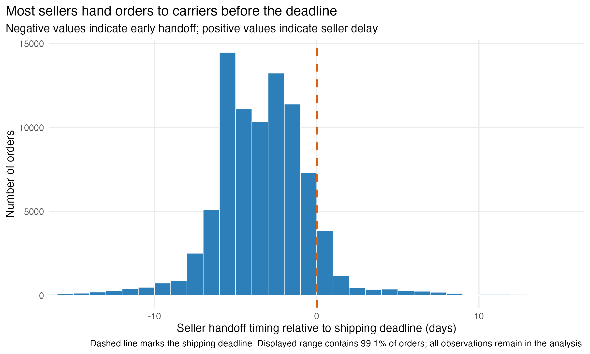
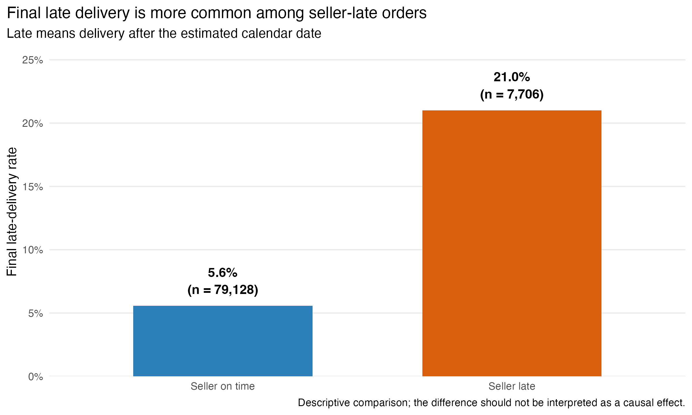

```{r}
#| include: false
source("scripts/02_milestone3_eda.R")

seller_late_rate <- overall_summary$seller_late_rate
median_seller_delay <- overall_summary$median_seller_delay_days

on_time_rate <- summary_by_seller |>
  filter(seller_status == "Seller on time") |>
  pull(final_late_rate)

late_rate <- summary_by_seller |>
  filter(seller_status == "Seller late") |>
  pull(final_late_rate)

rate_difference <- late_rate - on_time_rate
```

## Research question and data

How are seller handoff delays associated with final delivery performance, and
under what conditions do seller-side delays translate into late customer
deliveries?

We use the Olist Brazilian E-Commerce Public Dataset and focus on 86,834
delivered single-item orders. Restricting the sample to single-item orders
avoids assigning multiple sellers or shipping deadlines to one order. Seller
delay is the difference between the actual carrier handoff timestamp and the
seller shipping deadline. Final delivery is classified as late only when the
actual delivery calendar date is later than the estimated delivery calendar
date. The analysis is descriptive and associational, not causal.

## Seller handoff timing

{#fig-seller-delay width=80%}

@fig-seller-delay shows that seller handoffs are concentrated before the
shipping deadline. The median order was handed off
`r sprintf("%.1f", abs(median_seller_delay))` days early, while
`r sprintf("%.1f", 100 * seller_late_rate)`% were handed off late. The visible
right tail motivates examining whether seller delay is associated with final
delivery performance.

## Final delivery performance by seller status

{#fig-final-late width=88%}

@fig-final-late shows a clear descriptive difference in final delivery
performance. The observed final late-delivery rate was
`r sprintf("%.1f", 100 * on_time_rate)`% among seller-on-time orders and
`r sprintf("%.1f", 100 * late_rate)`% among seller-late orders, a difference of
`r sprintf("%.1f", 100 * rate_difference)` percentage points. This pattern
supports further analysis of the association between seller delay and final
delivery outcomes. Because the data are observational, the difference does not
show that seller delay causes final late delivery.

## Planned analysis

The next stage will examine the relationship between `seller_delay_days` and
`final_delay_days` using correlation, descriptive group comparisons, and linear
regression. We will also examine whether the observed association differs
across relevant order and logistics conditions. Any findings will be described
as associations rather than causal effects.

## Data source

Olist. *Brazilian E-Commerce Public Dataset*. Kaggle.
<https://www.kaggle.com/datasets/olistbr/brazilian-ecommerce>
